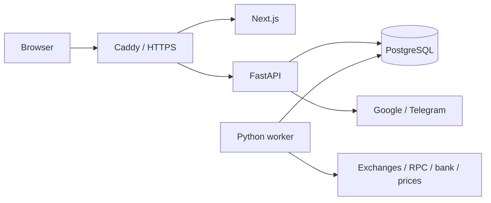

# Architecture

Contour is a multi-user modular monolith for local development and small VM deployments.

Native development uses Next.js rewrites instead of Caddy and can use SQLite.

## Ownership

| Entity | Responsibility |
| --- | --- |
| `users` | Account status and default synchronization interval |
| `identities` | Unique provider/subject pairs associated with users |
| `web_sessions` | Hashed session tokens, expiry, CSRF tokens, user ownership |
| `oauth_states` | Browser-bound encrypted authorization transactions |
| `auth_rate_limits` | Shared login attempt counters |
| `sources` | User-owned exchange, wallet, bank, and manual sources |
| `snapshots` | Historical holdings, positions, warnings, valuation, price coverage |
| `schema_versions` | Database format marker |

Every source has a non-null user foreign key. Snapshot ownership follows its source. Portfolio, history, duplicates, edits, archives, and refresh operations are scoped to the authenticated user. Client-supplied ownership fields are rejected; another user's source returns 404.

No user is created at startup. There is no special owner or password login. Linking identities does not transfer portfolio data between users.

## Authentication boundary

The API verifies ID tokens before creating users or sessions. Sessions, rate limits, and OAuth transactions live in the database. The frontend receives an application cookie and CSRF token, not provider tokens or client secrets.

On the VM, only Caddy's fixed private IP is trusted to forward client addresses. Redirect URLs come from server configuration.

## Synchronization

1. The worker selects due active sources.
2. A compare-and-set update claims a lease for up to 15 minutes.
3. The adapter reads balances and derives holdings and positions.
4. Before publishing, the worker verifies lease ownership.
5. Success creates a snapshot and schedules the next update using the source override or its user's interval.
6. Failure retains the previous snapshot and schedules a bounded retry.

The worker polls every 15 seconds and processes up to 20 sources sequentially per batch. Leases prevent duplicate publication, but large deployments still need provider-quota, fairness, and throughput planning.

Manual edits create snapshots immediately. Later synchronization reprices the recorded quantity. Archiving excludes the source from the current portfolio while retaining history.

## Valuation

Backend amounts use Decimal and serialize as strings. Browser numbers are used for presentation. Futures equity includes unrealized PnL; position notional is not added again.

Missing prices remain explicit and are excluded from monetary totals. Unpriced holdings are hidden from the table; the under-$1 filter changes only presentation. Locked manual holdings remain in total value and are excluded from available crypto.

Snapshots are per source, not cross-provider atomic transactions. Transfers can temporarily appear twice or not at all until synchronization completes. Portfolio history is not a return or realized-profit calculation.

## Operations

API and worker share the same database and encryption key. The running server can decrypt source credentials; application operators remain trusted parties.

Both Docker stacks keep PostgreSQL and the API private. The VM exposes Caddy on ports 80/443. This release has no legacy migration framework; future schema changes require an explicit upgrade design. See [VM deployment](DEPLOYMENT_VM.md).
